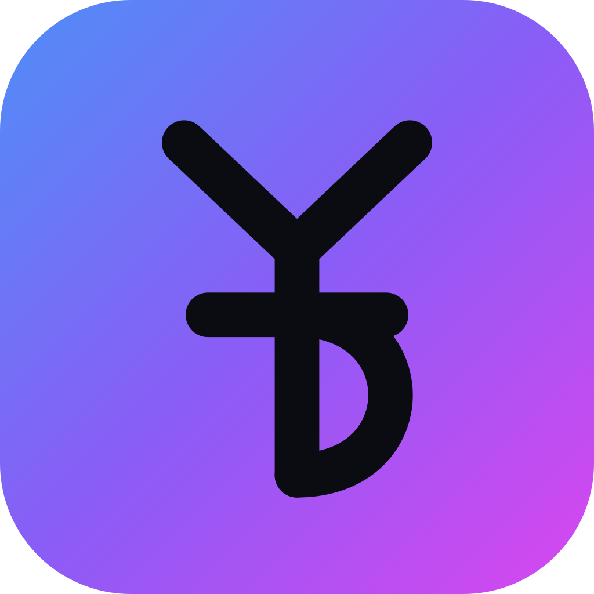

<div align="center">



# YTDownload

**Un descargador de YouTube que hace justo lo que le pediste. Nada más.**

Descarga un video suelto o una playlist entera, en MP3 o MP4.
Sin anuncios. Sin límites. Sin cuentas. Sin telemetría.

[](LICENSE)
[](https://tauri.app)

[English](README.md) · [Cómo contribuir](CONTRIBUTING.md) · [Reportar un fallo](../../issues/new?template=bug_report.yml)

</div>

---

## Por qué existe

Casi todas las apps de escritorio para "descargar de YouTube gratis" son una
capa fina sobre [yt-dlp](https://github.com/yt-dlp/yt-dlp), más anuncios, más
una versión de pago, más un SDK de telemetría que nadie te pidió aceptar. Este
proyecto nació al abrir una de ellas y encontrar dentro una librería de
*desktop back-connect* y un envío de datos con `device_id`, `total_ram_mb`,
`available_storage` y bastante más.

Así que: el mismo motor, sin nada de eso. La app entera son cuatro archivos.
Puedes leértela en una tarde y arreglarla tú el día que YouTube cambie algo.

## Qué hace

**Descargas**
- Videos sueltos y playlists enteras, en **MP3** o **MP4**, eligiendo calidad
  (320–128 kbps, o de 4K a 480p).
- Si pegas la URL de un video que además está en una lista, te pregunta si
  quieres **solo ese video o la playlist entera**. Al elegir el video usa la
  URL limpia, para que yt-dlp no pueda arrastrar la lista de todos modos.
- Hasta **10 descargas a la vez**, configurable.
- **Solo el archivo que pediste.** Ni portadas, ni metadata, ni `.json`
  sueltos, ni subtítulos: se fuerza con flags negativos explícitos y con
  `--ignore-config`, para que ninguna configuración global pueda colártelos.

**La cola**
- Pestañas de **todas / en cola / descargando / pendientes / completadas /
  fallidas**, con su contador.
- **Descargar más tarde**: en vez de encolar, guarda lo analizado en
  **Pendientes**, donde no se descarga nada hasta que tú lo digas — fila a
  fila, las seleccionadas, o todas de golpe.
- La barra de acciones es **contextual**: en Fallidas ofrece "quitar
  fallidas", en Pendientes solo "descargar ahora", y los botones que no
  tienen nada sobre lo que actuar no aparecen.
- Lo que se está descargando se resalta y sube arriba; al terminar se queda
  donde está en vez de saltar al fondo.
- **Reintentar** una o todas las fallidas. Seleccionar varias y quitarlas.
- **Quitar solo borra la fila, nunca el archivo del disco.**
- **Ver en carpeta** abre el explorador con el archivo ya seleccionado.
- Un video privado o borrado **no tumba la cola**: se salta y se cuenta.
- Las filas se pintan de 10 en 10 al bajar, así una playlist de 300 no
  redibuja la lista entera en cada actualización del progreso.

**Se acuerda de todo**
- La cola **se guarda en disco** y sigue ahí la próxima vez que abras la app.
  Lo que quedó a medias vuelve a la cola, sin reanudarse solo.
- Carpeta por defecto distinta para **música y video**, para no mezclarlas.
- **Español e inglés**, y el idioma se recuerda.

**Detalles**
- **Sin timeouts inventados.** Que una playlist tarde horas no es un fallo.
- Avisos por cada canción al terminar o al fallar.
- El botón de actualizar yt-dlp **solo aparece cuando de verdad hay una
  versión más nueva**.
- La app **avisa cuando hay una versión nueva de sí misma** y te lleva a la
  descarga. No se instala sola: te dice que existe y decides tú. En **Ajustes**
  hay además un botón para **buscar actualizaciones** cuando quieras, junto a
  la versión que tienes instalada.
- El historial guarda hasta **10.000 descargas**.

## Cómo se usa

1. **Pega la URL** de un video o de una playlist y pulsa **Analizar**.
2. Si la URL lleva video y lista a la vez, elige **qué descargar**.
3. Elige **MP3 o Video** y la calidad. Si es playlist, puedes crear una
   **subcarpeta con su nombre** (viene desactivado). La ruta final se ve
   siempre antes de descargar.
4. **Añadir a la cola**: empieza sola, no hay que pulsar nada más. O
   **Descargar más tarde**, y se queda en Pendientes esperando.
5. Sigue el progreso en las pestañas. Al acabar, el icono de carpeta de cada
   fila te lleva al archivo.

En **Ajustes** (el engranaje) cambias el idioma, cuántas descargas van a la
vez, las carpetas por defecto, y puedes borrar el historial (que no toca
ningún archivo descargado).

## Instalación

### Requisitos

Necesitas `yt-dlp` y `ffmpeg` en el sistema. YTDownload no los empaqueta: así
la app pesa poco y actualizas por tu cuenta la pieza que de verdad importa.

```bash
# macOS
brew install yt-dlp ffmpeg

# Debian / Ubuntu
sudo apt install ffmpeg && sudo pipx install yt-dlp

# Windows
winget install yt-dlp.yt-dlp Gyan.FFmpeg
```

Si falta alguno, la app te dice cuál y el comando exacto para instalarlo.

### Descargar una versión

En [Releases](../../releases).

#### En macOS, la primera vez

YTDownload no está firmado ni notarizado por Apple (hace falta una cuenta de
desarrollador, 99 $/año), así que macOS lo bloquea al abrirlo. Es cosa de una vez:

Descarga el `.dmg` que corresponda a tu Mac: **aarch64** para los Apple
Silicon (M1, M2, M3, M4) y **x64** para los Intel. Comprueba cuál tienes con
`uname -m` en la Terminal: `arm64` o `x86_64`.

Arrastra **YTDownload** a tu carpeta Aplicaciones y luego, **una sola vez**,
abre la Terminal y ejecuta:

```bash
xattr -dr com.apple.quarantine /Applications/YTDownload.app
```

Después ya se abre con doble clic como cualquier otra app.

> **Sí, hace falta la Terminal.** Al no estar firmada con un certificado de
> Apple, macOS no dice "desarrollador no identificado" (que se resuelve desde
> Ajustes con *Abrir de todos modos*), sino **"está dañado y no puede
> abrirse"**. Ante ese mensaje concreto **el sistema no ofrece ninguna opción
> para permitirlo**, y la única salida es quitar la marca de cuarentena con el
> comando de arriba. La app no está dañada: el comando solo borra la etiqueta
> que el navegador le pone a lo descargado.

O compílalo tú, que tarda dos minutos y evita el aviso del todo.

### Compilar desde el código

```bash
git clone https://github.com/JSNavas/YTDownload.git
cd YTDownload
npm install
npm run dev     # desarrollo
npm run build   # genera el instalador en src-tauri/target/release/bundle/
```

Necesitas [Rust](https://rustup.rs) y [Node](https://nodejs.org) 18+.

## Cómo está hecho

```
src/                      Frontend: HTML/CSS/JS a pelo, sin framework ni build
  index.html
  main.js                 Llama a los comandos de Rust y escucha download-progress
  styles.css              Tema claro/oscuro automático
src-tauri/src/lib.rs      Backend: localiza las herramientas, analiza URLs, descarga
```

La cola vive en el frontend y el backend descarga **un video por llamada**:
eso es lo que permite tener estado, reintentos y cancelación por item. yt-dlp
nunca ve la playlist entera.

El progreso se parsea con un `--progress-template` propio, mucho más fiable que
leer la salida humana de yt-dlp, y llega a la interfaz como eventos. Ojo con un
detalle que cuesta encontrar: `--print` pone a yt-dlp en modo silencioso y eso
**suprime las líneas de progreso**, así que hacen falta `--progress --no-quiet`
para recuperarlas.

El backend expone 14 comandos: `check_tools`, `check_update`, `update_ytdlp`,
`probe_url`, `download_item`, `cancel_item`, `cancel_all`, `resolve_target`,
`default_dest`, `open_folder`, `reveal_file`, `load_history`, `save_history` y
`clear_history`.

El historial se guarda en la carpeta de datos del usuario, con escritura
atómica (archivo temporal y renombrado) para que una caída a media escritura
no lo deje truncado.

### Qué sale a internet, todo

La app hace exactamente dos peticiones, las dos opcionales y ninguna lleva nada tuyo:

| Petición | Para qué |
|---|---|
| `api.github.com/repos/yt-dlp/yt-dlp/releases/latest` | Ver si hay un yt-dlp más nuevo |
| `api.github.com/repos/JSNavas/YTDownload/releases/latest` | Ver si hay una versión nueva de YTDownload |
| `i.ytimg.com` | Mostrar la miniatura en la ventana |

Todo lo demás es `yt-dlp` hablando con YouTube, como es de esperar.

## Contribuir

Las contribuciones son bienvenidas de verdad: es poco código y se lee bien, así
que es un buen sitio para empezar. Mira [CONTRIBUTING.md](CONTRIBUTING.md).

La interfaz viene en español e inglés. **Añadir un tercer idioma es un buen
primer aporte**: todos los textos están en un único objeto `I18N` dentro de
`src/main.js`, así que un idioma nuevo es una entrada más.

## Aviso legal

YTDownload es una interfaz para yt-dlp. Está pensado para descargar contenido
propio, de dominio público, con una licencia que lo permita, o tus propios
archivos para verlos sin conexión. Descargar material con copyright sin permiso
puede incumplir los Términos de Servicio de YouTube y la ley de tu país. Lo que
descargues es responsabilidad tuya.

## Licencia

[MIT](LICENSE). yt-dlp y ffmpeg son proyectos aparte con sus propias licencias.
