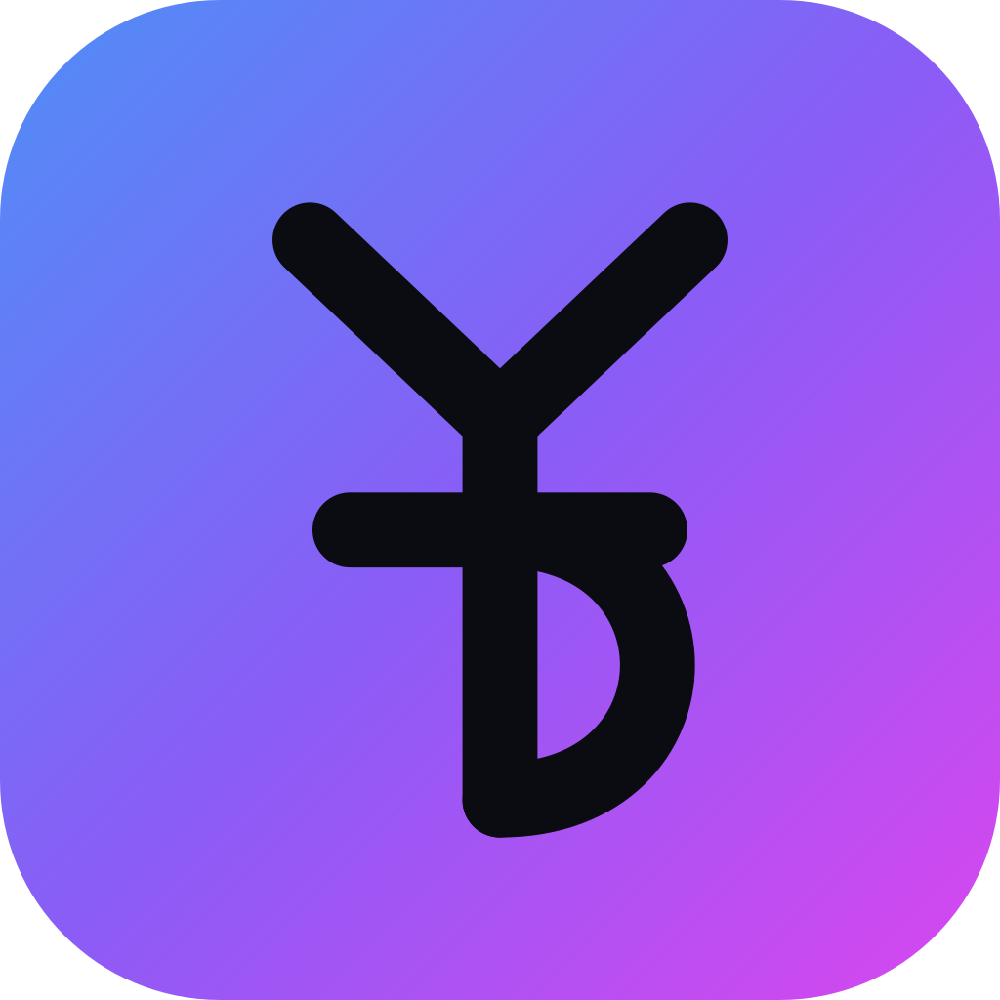

<div align="center">



# YTDownload

**A YouTube downloader that does exactly what you asked for. Nothing else.**

Download a single video or a whole playlist, as MP3 or MP4.
No ads. No limits. No accounts. No telemetry.

[](LICENSE)
[](https://tauri.app)
[](CONTRIBUTING.md)

[Español](README.es.md) · [Contributing](CONTRIBUTING.md) · [Report a bug](../../issues/new?template=bug_report.yml)

</div>

---

## Why this exists

Most "free YouTube downloader" desktop apps are a thin wrapper around
[yt-dlp](https://github.com/yt-dlp/yt-dlp) — plus ads, plus an upsell, plus a
telemetry SDK you never agreed to. This project started after taking one of
them apart and finding a bundled "desktop back-connect" library and a telemetry
payload carrying `device_id`, `total_ram_mb`, `available_storage` and more.

So: same engine, none of that. The whole app is four source files. You can read
all of it in an afternoon, and fix it yourself when YouTube changes something.

## Features

- **Videos and playlists.** Paste a URL, it figures out which one it is.
- **MP3 or MP4**, with a quality picker (320–128 kbps, or 4K down to 480p).
- **You decide where it goes.** Optional subfolder named after the playlist —
  off by default, because creating folders you didn't ask for is rude. The
  final path is always shown before you press Download.
- **Only the file you asked for.** No cover art, no metadata, no `.json`
  sidecars, no subtitles — enforced with explicit negative flags *and*
  `--ignore-config`, so no stray global config can slip them back in.
- **No invented timeouts.** A long playlist is not a failure.
- **A broken video doesn't kill the queue.** Private or deleted entries are
  skipped and counted; the rest keep going.
- **Resumable.** A download archive lives in the destination folder, so
  re-running never re-downloads what you already have.
- **Honest update check.** The update button only appears when a newer yt-dlp
  actually exists.

## Install

### Requirements

`yt-dlp` and `ffmpeg` must be on your system. YTDownload does not bundle them —
that keeps the app tiny and lets you update the part that actually matters.

```bash
# macOS
brew install yt-dlp ffmpeg

# Debian / Ubuntu
sudo apt install ffmpeg && sudo pipx install yt-dlp

# Windows
winget install yt-dlp.yt-dlp Gyan.FFmpeg
```

If either is missing, the app tells you which one and the exact command to fix it.

### Download a release

Grab the latest build from [Releases](../../releases).

#### First launch on macOS

YTDownload is not signed or notarised by Apple (that needs a developer account
at $99/yr), so macOS blocks it the first time. This is a one-off:

1. Open the `.dmg` and drag **YTDownload** into your Applications folder.
2. Open it. macOS will say it cannot be verified or that it comes from an
   unidentified developer. Click **OK** or **Done**.
3. Go to **System Settings → Privacy & Security**, scroll to the message about
   YTDownload and click **Open Anyway**.
4. Open it again and confirm. From then on it launches normally.

If you prefer the terminal, one line does the same thing:

```bash
xattr -dr com.apple.quarantine /Applications/YTDownload.app
```

Or build it yourself — two minutes, and no warning at all.

### Build from source

```bash
git clone https://github.com/JSNavas/YTDownload.git
cd YTDownload
npm install
npm run dev     # development
npm run build   # produces an installer in src-tauri/target/release/bundle/
```

You need [Rust](https://rustup.rs) and [Node](https://nodejs.org) 18+.

## How it works

```
src/                      Frontend — plain HTML/CSS/JS, no framework, no build step
  index.html
  main.js                 Calls the Rust commands, listens for download-progress
  styles.css              Automatic light/dark theme
src-tauri/src/lib.rs      Backend — finds the tools, inspects URLs, runs downloads
```

The backend exposes eight commands: `check_tools`, `check_update`,
`update_ytdlp`, `probe_url`, `start_download`, `cancel_download`,
`resolve_target` and `open_folder`.

Progress is parsed from a custom `--progress-template`, which is far more
reliable than scraping yt-dlp's human-readable output, and streamed to the UI
as `download-progress` events.

### Network activity, in full

The app itself makes exactly two requests, both optional and neither carrying
anything about you:

| Request | Why |
|---|---|
| `api.github.com/repos/yt-dlp/yt-dlp/releases/latest` | Check whether a newer yt-dlp exists |
| `i.ytimg.com` | Show the thumbnail in the window |

Everything else is `yt-dlp` talking to YouTube, as you'd expect.

## Contributing

Contributions are genuinely welcome — this is a small, readable codebase, which
makes it a good one to start with. See [CONTRIBUTING.md](CONTRIBUTING.md).

Good places to start are marked
[`good first issue`](../../issues?q=is%3Aissue+is%3Aopen+label%3A%22good+first+issue%22).
The interface is currently Spanish-only, so **adding i18n is the single most
useful contribution right now**.

## Legal

YTDownload is a front-end for yt-dlp. It is intended for downloading content you
own, content in the public domain, content under a license that permits it, or
your own media for offline use. Downloading copyrighted material without
permission may violate YouTube's Terms of Service and the law where you live.
You are responsible for what you download.

## License

[MIT](LICENSE). yt-dlp and ffmpeg are separate projects under their own licenses.
